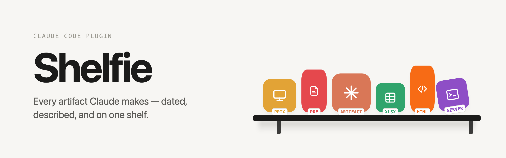
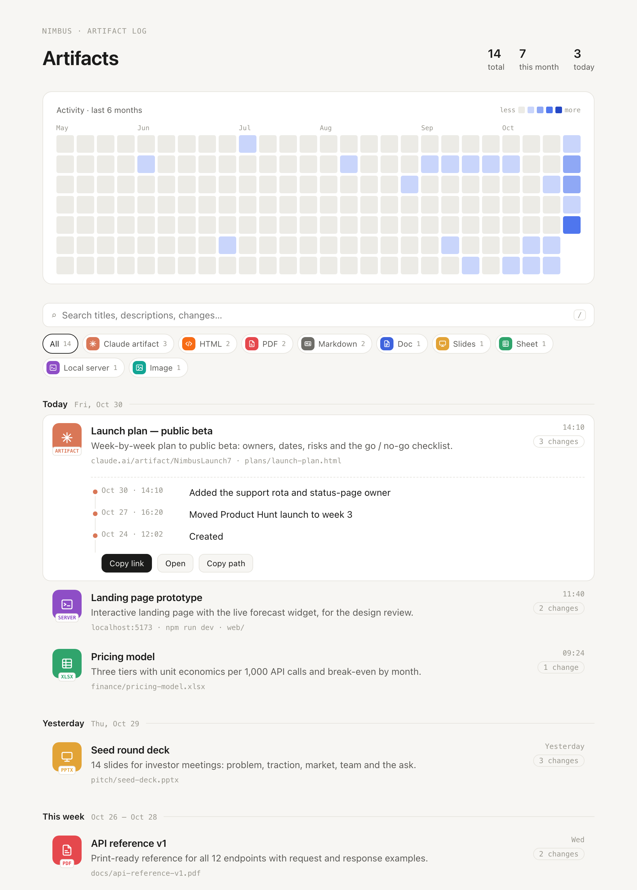

<p align="center">
  <picture>
    <source media="(prefers-color-scheme: dark)" srcset="docs/assets/banner-dark.png">
    
  </picture>
</p>

<p align="center">
  <a href="https://github.com/octozaur/shelfie/actions/workflows/tests.yml"></a>
  <a href="https://github.com/octozaur/shelfie/releases"></a>
  <a href="LICENSE"></a>
  
  
  <a href="https://code.claude.com/docs/en/plugins"></a>
</p>

**Automatic artifact log for Claude Code.** Every file, page and server Claude makes in a project — with dates, short descriptions and change history — on one page you can open from Finder.

<picture>
  <source media="(prefers-color-scheme: dark)" srcset="docs/assets/screenshot-dark.png">
  
</picture>

You ask Claude for a dashboard, a PDF guide, a pitch deck, a prototype on `localhost`. A week later you're scrolling a chat to find it. Shelfie keeps the shelf for you:

- **Captured automatically.** Hooks notice new and changed files, pages published to claude.ai, and local servers. Nobody has to remember anything.
- **Described while the context is fresh.** At the end of a reply, Claude is asked once to say what each new item is — and whether it's a real deliverable at all. READMEs, scratch notes and throwaway servers are filtered out.
- **Change history.** One line per session: *"Added the FAQ section"*, *"Week 3 results"*.
- **Find it by date.** A GitHub-style activity map, a timeline grouped by day / week / month, search, and type filters with icons.
- **Local and private.** Everything lives in your project's `.shelfie/` folder. The dashboard is a single static HTML file — no server, no network requests.

> [!NOTE]
> Shelfie never uploads anything. It only reads what Claude Code's hooks tell it and the files in your project, and writes to `.shelfie/`.

## Install

Shelfie installs per project.

```bash
claude plugin marketplace add octozaur/shelfie
claude plugin install shelfie@shelfie --scope project
```

Start Claude in the project. On the first session Claude asks you two things:

1. **Which formats to track** (default: all of them).
2. **Whether Shelfie may record its notes without permission prompts.** If you agree, one allow rule for Shelfie's own `note` command (`<project>/.shelfie/bin/shelfie note …`) is added to `.claude/settings.local.json` — your personal, uncommitted settings. If you decline, Shelfie still works, but you'll approve each note.

Requires `python3` (3.9+, standard library only — the one that ships with macOS is fine). macOS and Linux.

## What gets tracked

| Type | Icon label | What |
|---|---|---|
| Claude artifact | `ARTIFACT` | A page published to claude.ai (Claude desktop app). If it was published from a file in the project, file and page are one entry. |
| HTML | `HTML` | `.html`, `.htm` |
| PDF | `PDF` | `.pdf` |
| Markdown | `MD` | `.md`, `.markdown` |
| Doc | `DOCX` | `.docx`, `.doc`, `.odt`, `.rtf` |
| Slides | `PPTX` | `.pptx`, `.key`, `.odp` |
| Sheet | `XLSX` | `.xlsx`, `.xls`, `.csv`, `.tsv`, `.ods` |
| Local server | `SERVER` | A prototype or app Claude runs on `localhost` — recorded with the command, folder and port so you can start it again |
| Image | `IMG` | `.png`, `.jpg`, `.jpeg`, `.gif`, `.webp`, `.svg` |

Only changes made **while Claude is working on a reply** count — your own edits between turns, `git pull` or cloud sync never show up. A burst of many new files of one type in one folder (say, 74 generated levels) becomes a single entry. Deleted files stay in the log, greyed out as *missing*.

## Commands

| | |
|---|---|
| `/shelfie` | Open the dashboard (`.shelfie/shelfie.html`) |
| `/shelfie formats` | See and change which formats are tracked |
| `/shelfie ignored` | See what Claude decided was not an artifact |
| `/shelfie restore <id>` / `/shelfie ignore <id>` | Put an item back, or hide one |
| `/shelfie setup` | Re-run the first-run questions |

You can also run `.shelfie/bin/shelfie --help` in a terminal.

## How it works

```
UserPromptSubmit ─ marks the start of the turn
PostToolUse ────── claude.ai publishes, dev-server starts, .claude/launch.json
Stop ───────────── scans for files changed during the turn → registry
                   new or changed items? → asks Claude once:
                   .shelfie/bin/shelfie note <id> --artifact yes|no --title … --desc … --change …
                   → re-renders .shelfie/shelfie.html
```

Claude is asked about an item at most once per session, so editing the same file ten times in one conversation produces one history line.

Files in `.shelfie/`:

- `config.json` — tracked formats and extra exclude globs (e.g. `"exclude": ["drafts/*"]`)
- `registry.json` — the log itself
- `shelfie.html` — the dashboard (regenerated; safe to delete)
- `bin/shelfie` — project launcher, refreshed every session

> [!TIP]
> Whether to commit `.shelfie/` is up to you: add it to `.gitignore` to keep the log personal, or commit `registry.json` to share it with the team.

## Development

```bash
python3 -m unittest discover -s tests -t .
python3 tests/fixtures/make_demo.py /tmp/nimbus         # demo dashboard (the one in the screenshot)
claude --plugin-dir /path/to/shelfie                    # try it in any project
```

Changes are listed in [CHANGELOG.md](CHANGELOG.md). Bug reports and ideas are welcome in [issues](https://github.com/octozaur/shelfie/issues).

## License

[MIT](LICENSE)
